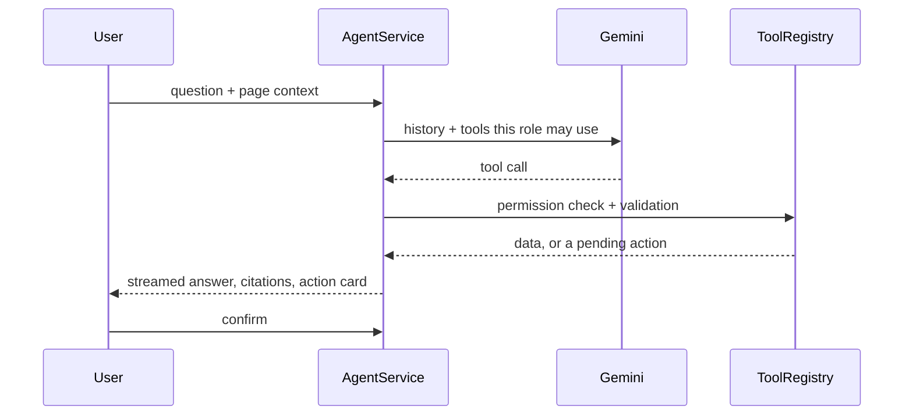

<div align="center">

<h1>Pranava Holla</h1>

<p><b>Agentic AI engineer</b> &nbsp;·&nbsp; founder of <a href="https://webfixus.com">WEBFIXUS</a> &nbsp;·&nbsp; Bangalore, India</p>

<p><i>"An agent is only as trustworthy as its boundary: the tools it gets,<br>what needs a person's approval, and what still works when the model doesn't."</i></p>

<p>
  <a href="mailto:pranavarholla@gmail.com"></a>
  <a href="https://webfixus.com"></a>
  <a href="#project-showcase"></a>
</p>

</div>

<br>

<table>
<tr>
<td width="58%" valign="top">

### Who I am

I build agents that take real actions: they write records, change calendars, draft reports and run on people's own machines. Most of the work isn't the prompt. It's the boundary around the agent: which tools it gets, which calls need a person's approval, how many steps it may take, what it costs, and what still works when the model is wrong, slow, or missing.

Three of those systems are below, along with the labs I built to understand what they stand on. I also run WEBFIXUS, a small studio that ships client sites.

</td>
<td width="42%" valign="top">

### At a glance

```yaml
role:     Agentic AI engineer
based:    Bangalore, India
building: Rudra OS · SilverSync · Xotch
focus:    tool-using agents,
          human-in-the-loop approvals,
          local-first AI
models:   Claude · Gemini · Ollama ·
          OpenAI-compatible
agents:   LangChain · CrewAI · Pydantic
code:     Python · TypeScript · Swift
```

</td>
</tr>
</table>

## Project showcase

Click a project to read how it works.

### [Rudra OS](https://github.com/Pranava77/rudra-os): a local-first personal OS with a bounded agent runtime

`Python 3.12` · `FastAPI` · `SQLite + FTS5` · `Pydantic` · `MCP` · `TypeScript` · MIT

Goals, tasks, commitments, decisions, ideas, reading and memory in **one SQLite file on your own machine**, built to answer one question well: *given everything relevant about me, what matters right now, why, and what should I do next?*

<details>
<summary><b>How it works</b></summary>
<br>

```
$ rudra today

PRACTICAL
Today — 110 of 240 minutes
  Answer the vendor email
      why: scores 3.60 — a deadline is close (1.20); someone is expecting
           it (1.10); small enough to finish (0.50)
```

**The agent runtime**
- Every run is bounded in steps, runtime, tool calls and cost.
- 26 tools. Any high-risk action waits for an approval tied to its exact arguments.
- Terminal, local API, a 40-screen desktop Control Center, Telegram and an MCP bridge into your editor all go through **one request layer with 122 typed request kinds**, so no surface can act differently from another.
- The phone deliberately leaves out ten of the thirty write actions: the ones that would weaken a control, or need input a thumb can't give. `/help` says which and why.

**What it refuses to do**
- It can't send email, messages or posts. Drafts are written, checked and never sent.
- Nothing leaves the machine. The API binds to loopback only, and an invariant check names every module allowed to open a socket.
- A reminder with no stated time fails loudly instead of guessing one.
- What you capture is never rewritten. Refining an idea creates a child and keeps the parent.

**Scale:** about 39,700 lines of Python and 5,300 of TypeScript, 67 tables, 21 reversible migrations, 11 automations, checked with `ruff`, `mypy --strict` and eleven architectural invariants. Its [AS_BUILT record](https://github.com/Pranava77/rudra-os/blob/main/docs/AS_BUILT.md) lists what isn't built as plainly as what is.

</details>

---

### [SilverSync](https://github.com/Pranava77/SilverSync): a care-home operations app with a human-in-the-loop agent

`React 18` · `TypeScript` · `FastAPI` · `SQLAlchemy 2` · `Gemini` · `ChromaDB`

Staff see residents, medication, billing, staff and documents in one place, with an assistant that reads the home's own records and drafts changes for a person to confirm.

<details>
<summary><b>How it works</b> (screenshot and agent diagram inside)</summary>
<br>


Dementia-friendly care homes paint each resident's door its own colour, so the dashboard draws the home as corridors of those doors.

**The agent**
- A Gemini agent with **18 tools** across retrieval, residents, medical, accounting, HR, documents and reports.
- Responses stream over Server-Sent Events, showing each step, tool call and result, then the records it cited.
- **Writes are proposals.** `create_medical_record`, `record_payment` and `update_leave_status` never write. Each one stores a pending action, and only the person who asked can confirm it. Confirming runs the change through the normal domain service.
- **Role-scoped everything.** Six roles (admin, doctor, nurse, accountant, HR, receptionist). The model is only offered the tools that role may use, and search and the assistant see only what that role can see.
- Every tool call is validated with Pydantic, checked for permission and written to an audit row.



**Around it:** semantic search over records and uploaded documents (ChromaDB), document review that suggests a category, resident and summary (and drops any resident that isn't real), and report drafts. Refill and overdue-invoice alerts are deterministic, with no AI involved. Admins can rotate the API key without a restart, and saved keys are stored encrypted. Without a key, everything except the AI still works. Tested with 49 tests against a scripted fake LLM, so no API key is needed.

</details>

---

### [Xotch](https://github.com/Pranava77/Xotch): an AI in the MacBook notch that acts only after you click Allow

`Swift 6` · `SwiftUI` · `AppKit` · on-device speech · private beta

A native macOS app that turns the notch, or a drawn one on any display, into a control surface for the things you do fifty times a day.

<details>
<summary><b>How it works</b> (screenshot inside)</summary>
<br>


**The agent**
- Chat with Claude, GPT, Gemini or a local model through Ollama or LM Studio, from any app with <kbd>⌘⇧Space</kbd>.
- **20 notch tools** over your calendar, to-dos, timer and notes, with one streaming backend per provider that rebuilds tool calls arriving in pieces.
- Each tool is typed `look`, `share` or `change`. Looking runs at once. Sharing your clipboard or notes, or changing anything, waits on an **Allow** card, and most changes can be undone from that card.
- At most five tool rounds per answer. A model that refuses tools is asked again without them, and that's remembered.

**Dictation that never leaves the Mac:** hold <kbd>Fn</kbd>, speak, let go, and the text appears where you're typing. Five seconds of speech is transcribed in about 30 ms, in a separate helper process. Your voice is never saved or sent.

**Built small:** about 23,500 lines of Swift 6 with strict concurrency and no third-party Swift packages. A closed notch measures about 0.3% CPU and 29 MB of memory, with every number in the docs measured, not estimated. It has no account, analytics or telemetry, and API keys live in the Keychain. Start with its [engineering notes](https://github.com/Pranava77/Xotch/blob/main/docs/ENGINEERING.md).

</details>

---

### [Syncner](https://github.com/Pranava77/syncner-test): a learning platform with a Gemini career mentor

`React` · `TypeScript` · `Redux` · `Express` · `MongoDB`

Structured learning paths, progress tracking and generated student portfolios, across separate student, staff and admin surfaces.

<details>
<summary><b>How it works</b></summary>
<br>

- **The mentor:** a Gemini-backed career mentor that students talk to alongside their learning paths.
- **The API:** Express and MongoDB, with JWT auth, request validation, rate limiting and scheduled jobs.
- **Key handling:** the model key is read from admin settings before the environment, so rotating a key is a settings change rather than a redeploy.
- **Front end:** React and TypeScript with Redux, with separate student, staff and admin surfaces.

</details>

---

### [Multi-Agent Planning Studio](https://github.com/Pranava77/Multi_Agent_Planning_Orchestration_Studio): orchestration, shown without a model

`Python` · `FastAPI` · `SQLite`

A lab that makes multi-agent orchestration visible: a supervisor breaks a request into a task graph, specialist agents work through it, and a reviewer argues with the result.

<details>
<summary><b>How it works</b></summary>
<br>

- **Supervisor ("Orchestrator-Prime")** decomposes a query into a DAG of subtasks, dispatches them in dependency order, and writes the final report.
- **Specialist roles:** a data / SQL agent working over a small enterprise SQLite database, a quantitative analyst, and a critical reviewer that fact-checks the others adversarially.
- **Two orchestration patterns:** supervisor / hierarchical, and a sequential assembly pipeline, with agents sharing a blackboard memory.
- **Replanning:** when a step fails, the plan is revised and the run recovers instead of stopping.
- **Honest about what it is:** the agents are plain Python classes and no LLM is called, so what you see is the orchestration itself. There's a web UI and a CLI demo.

</details>

---

### [Advanced RAG Studio](https://github.com/Pranava77/Advanced_RAG_Pipelines_Studio_Live_Project): retrieval an agent can rely on

`Python` · `FastAPI` · `FAISS` · `BM25` · `sentence-transformers`

A lab for the retrieval half of an agent: rewrite the query, search two ways, re-rank, and answer only from what was found, with a trace of every stage.

<details>
<summary><b>How it works</b></summary>
<br>

1. **Query transformation:** multi-query expansion into three phrasings, a HyDE synthetic passage, and sub-query decomposition.
2. **Hybrid retrieval:** FAISS dense search over 384-dimensional embeddings plus BM25 keyword search, fused with reciprocal rank fusion (k = 60).
3. **Re-ranking:** an MS MARCO cross-encoder re-scores the candidates, and the UI shows how far each one moved.
4. **Grounded answers:** each answer cites its sources as `[Source N]`, with a side-by-side view of what an ungrounded answer gets wrong.
5. **Evaluation:** RAG-triad scoring and a naive-vs-advanced benchmark.

You can upload your own `.md` or `.txt` files and they're re-indexed immediately. Retrieval and re-ranking use real models; the answer step is templated per domain rather than an LLM, so the retrieval quality is what's on show.

</details>

---

## How I build agents

The same rules show up in every project, so here they are once, with where each one lives.

1. **Permission is part of the tool's type, not a prompt instruction.** In Xotch every tool is `look`, `share` or `change`, and only `look` runs without an Allow card. In SilverSync the three tools that change data can't write at all; they create a pending action.
2. **The loop belongs to me, not the SDK.** SilverSync runs its own tool loop instead of automatic function calling, so permission checks, streaming, auditing and confirmation stay in code I can read. Xotch caps the loop at five rounds and offers no tools on the last one, so the model has to answer.
3. **Approvals are bound to exact arguments.** In Rudra OS, an approval covers that one call with those arguments and nothing else, and you can give it from any surface, including a phone.
4. **Deterministic first, model last.** Briefings, priorities, alerts and calculations run with no model call. A model gets only the step that actually needs judgement, and each product works with no key configured.
5. **Remove a capability rather than guard it.** Rudra OS can't send a message on your behalf, and its `run_code` tool was deleted rather than gated: the agent writes the file it would ask to run, so "may I run this?" isn't a question you can usefully answer.
6. **Untrusted input is marked, not trusted.** Fetched content is stored `UNVERIFIED` and reaches the model inside a quotation fence, with instruction-shaped spans stripped and counted.
7. **The provider is swappable.** Rudra OS, SilverSync and Xotch each talk to models through their own provider-neutral types or adapters, so changing models is configuration, not a rewrite.

---

## The guardrails, side by side

| | Rudra OS | SilverSync | Xotch |
|---|---|---|---|
| **Tools** | 26 | 18 | 20 |
| **What needs a person** | High-risk actions, approved with their exact arguments | Every write: it becomes a pending action | Anything that shares or changes your data |
| **Loop limit** | Steps, runtime, tool calls and cost | Final step offers no tools | 5 rounds; no tools on the last |
| **Without a model** | The deterministic half runs fully | Everything but the AI; search falls back to an offline embedder | Everything but the chat |
| **Models** | Any OpenAI-compatible | Gemini, behind provider-neutral types | Claude, OpenAI-compatible, Gemini, Ollama, LM Studio |
| **Data stays** | On your machine, loopback only | In the home's own database | On your Mac unless you chose a cloud model |

---

## Now building

<table>
<tr>
<td width="50%" valign="top">

**Xotch**
- Developer ID signing and notarisation, so installs and updates take one click
- Approving Claude Code's requests straight from the notch
- Talking to the AI by voice, joining dictation and the assistant

</td>
<td width="50%" valign="top">

**Rudra OS**, gaps its own docs list as not built yet
- Feeding the pattern engine, so finished work becomes evidence for its hypotheses
- A bundled transcriber: voice notes are captured today, but labelled as untranscribed

</td>
</tr>
</table>

---

## Under the hood

Labs I built to understand the pieces an agent stands on, rather than just calling them. Each one says plainly which parts are real computation and which are simulated.

| Lab | What's real in it |
|---|---|
| Prompt Studio | Prompt linting, few-shot and chain-of-thought comparisons, and a prompt-injection scanner |
| Tokenizer Studio | BPE and WordPiece trained step by step; WordPiece, byte-level BPE, SentencePiece and tiktoken compared on the same text |
| Embeddings · Transformer · AutoEncoder | GloVe written from scratch in NumPy beside Word2Vec and FastText, a transformer block traced op by op with tensor shapes, PyTorch autoencoders |
| QLoRA & Evaluation | NF4 / INT4 quantization, LoRA adapters on a toy network, ROUGE / BLEU / token F1 |

---

## Toolbox

<p align="center">
  
</p>

| | |
|---|---|
| **Agents & LLMs** | Tool calling, hand-written agent loops, human-in-the-loop approvals, MCP, streaming (SSE), structured output with Pydantic · Claude, Gemini, OpenAI-compatible APIs, Ollama, LM Studio |
| **Agent frameworks** | LangChain, CrewAI, Pydantic |
| **Retrieval** | FAISS, BM25, ChromaDB, sentence-transformers, cross-encoder re-ranking, hybrid search with reciprocal rank fusion |
| **Backend** | Python, FastAPI, Pydantic v2, SQLAlchemy 2, SQLite / FTS5, Express, MongoDB, JWT |
| **Frontend & native** | TypeScript, React, Next.js, Vite, Tailwind, TanStack Query · Swift 6, SwiftUI, AppKit |
| **ML** | PyTorch, NumPy, pandas, scikit-learn, Jupyter |

---

## WEBFIXUS

I founded **[WEBFIXUS](https://webfixus.com)** in Bangalore in 2022. It's a small studio built on one idea: good digital work shouldn't need a 50-person agency. AI is how a small team keeps up, both inside our own workflow and in what we build for clients.

It's also where the agent work meets real clients. The habits in the showcase above (scoped tools, typed outputs, a human on anything that matters) are how we approach the AI integration work too.

**What the studio does**

| Service | What it covers |
|---|---|
| **Web design & development** | GSAP-animated, CMS-backed, performance-first sites, from marketing pages to full products |
| **AI integration & automation** | LLM pipelines, AI chat, intelligent dashboards and workflow automation, used where they actually help |
| **Branding & identity** | Logos, type systems, colour palettes, brand guidelines, motion identity |
| **Marketing & growth** | SEO, content, paid campaigns, conversion work, analytics dashboards |
| **Strategy & consulting** | Discovery, user research, information architecture, roadmapping |

**Selected client work**

| Client | What we built | Stack | Code |
|---|---|---|---|
| **Reguru** | Shopify storefront with Razorpay and Cashfree payments | Figma, Shopify, Liquid, JavaScript | [shopify-reguru](https://github.com/Pranava77/shopify-reguru) |
| **Techswamy** | Next.js site with a Payload CMS backend, smooth-scroll motion and Calendly booking | Next.js, Tailwind, Payload CMS, GSAP, Lenis | [techswamy](https://github.com/Pranava77/techswamy) |
| **Digital Mudrana** | Marketing site for a digital printing business | React, Vite, Tailwind, shadcn/ui | [repo](https://github.com/Pranava77/Digital-Mudrana) · [live](https://digital-mudrana.vercel.app) |
| **BGS High** | Animated school website | WordPress, GSAP, JavaScript | private |
| **BGS B-School** | Business school website | React, SCSS, Figma | private |
| **BGS PU** | College website with motion | React, GSAP, Figma | private |

Reusable [WordPress themes and plugins](https://github.com/Pranava77/wp-test) for client sites live in their own repo.

<details>
<summary><b>How a project runs</b></summary>
<br>

| Step | What happens |
|---|---|
| **1. Discover** | Audit, user flows, site map, personas, competitive research |
| **2. Design** | Wireframes, UI kit, prototype, visual system, interaction design |
| **3. Build** | Front end, CMS, GSAP motion, responsive pass, performance, AI features where they fit |
| **4. Launch** | Performance audit, go-live, analytics, post-launch support, iteration |

The studio's own site, [webfixus.com](https://webfixus.com), is a Next.js build on Vercel. The earlier GSAP version is public as [webfixus_final](https://github.com/Pranava77/webfixus_final).

</details>

[](https://webfixus.com) [](https://linkedin.com/company/webfixus) [](https://instagram.com/webfixus)

## Before this

Before WEBFIXUS I worked in analytics: [credit risk](https://github.com/Pranava77/Banking-credit-risk-analytics), [customer segmentation](https://github.com/Pranava77/Customer-Segmentation-for-one-of-the-leading-credit-card-company) and [spend drivers](https://github.com/Pranava77/Credit-Card-Spend-Identifying-the-key-drivers-of-card-spend-). It's why I'd rather a pipeline be boring than clever.

---

<div align="center">

**Building agents that need to be trusted? Let's talk.**

[Email](mailto:pranavarholla@gmail.com) · [WEBFIXUS](https://webfixus.com) · [GitHub](https://github.com/Pranava77)

</div>
