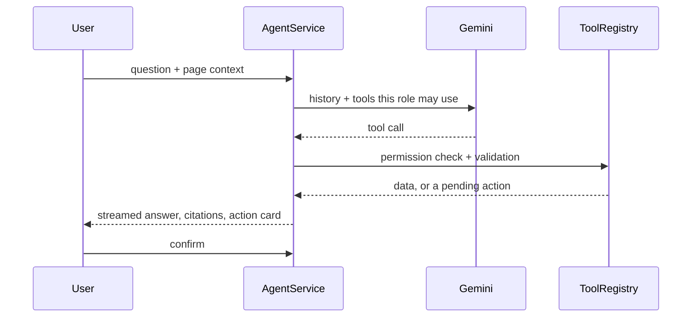

# Pranava Holla

**Agentic AI engineer** · Bangalore · [WEBFIXUS](https://webfixus.com) · [email](mailto:pranavarholla@gmail.com)

I build agents that take real actions: they write records, move money, change calendars and run on people's own machines. Most of the work isn't the prompt. It's the boundary around the agent: which tools it gets, which calls need a person's approval, how many steps it may take, what it costs, and what still works when the model is wrong, slow, or missing.

Three of those systems are below, along with the labs I built to understand what they stand on.

---

## How I build agents

The same rules show up in every project, so here they are once, with where each one lives.

1. **Permission is part of the tool's type, not a prompt instruction.** In Xotch every tool is `look`, `share` or `change`, and only `look` runs without an Allow card. In SilverSync the three tools that change data can't write at all; they create a pending action.
2. **The loop belongs to me, not the SDK.** SilverSync runs its own tool loop instead of automatic function calling, so permission checks, streaming, auditing and confirmation stay in code I can read. Xotch caps the loop at five rounds and offers no tools on the last one, so the model has to answer.
3. **Approvals are bound to exact arguments.** In Rudra OS, an approval covers that one call with those arguments and nothing else, and you can give it from any surface, including a phone.
4. **Deterministic first, model last.** Briefings, priorities, alerts and calculations run with no model call. A model gets only the step that actually needs judgement, and each product works with no key configured.
5. **Remove a capability rather than guard it.** Rudra OS can't send a message on your behalf, and its `run_code` tool was deleted rather than gated: the agent writes the file it would ask to run, so "may I run this?" isn't a question you can usefully answer.
6. **Untrusted input is marked, not trusted.** Fetched content is stored `UNVERIFIED` and reaches the model inside a quotation fence, with instruction-shaped spans stripped and counted.
7. **The provider is swappable.** Rudra OS, SilverSync and Xotch each talk to models through their own provider-neutral types or adapters, so changing models is configuration, not a rewrite.

---

## Featured work

### [Rudra OS](https://github.com/Pranava77/rudra-os): a local-first personal OS with a bounded agent runtime

`Python 3.12` · `FastAPI` · `SQLite + FTS5` · `Pydantic` · `MCP` · `TypeScript` · MIT

Goals, tasks, commitments, decisions, ideas, reading and memory in **one SQLite file on your own machine**, built to answer one question well: *given everything relevant about me, what matters right now, why, and what should I do next?*

```
$ rudra today

PRACTICAL
Today — 110 of 240 minutes
  Answer the vendor email
      why: scores 3.60 — a deadline is close (1.20); someone is expecting
           it (1.10); small enough to finish (0.50)
```

**The agent runtime**
- Every run is bounded in steps, runtime, tool calls and cost.
- 26 tools. Any high-risk action waits for an approval tied to its exact arguments.
- Terminal, local API, a 40-screen desktop Control Center, Telegram and an MCP bridge into your editor all go through **one request layer with 122 typed request kinds**, so no surface can act differently from another.
- The phone deliberately leaves out ten of the thirty write actions: the ones that would weaken a control, or need input a thumb can't give. `/help` says which and why.

**What it refuses to do**
- It can't send email, messages or posts. Drafts are written, checked and never sent.
- Nothing leaves the machine. The API binds to loopback only, and an invariant check names every module allowed to open a socket.
- A reminder with no stated time fails loudly instead of guessing one.
- What you capture is never rewritten. Refining an idea creates a child and keeps the parent.

**Scale:** about 39,700 lines of Python and 5,300 of TypeScript, 67 tables, 21 reversible migrations, 11 automations, checked with `ruff`, `mypy --strict` and eleven architectural invariants. Its [AS_BUILT record](https://github.com/Pranava77/rudra-os/blob/main/docs/AS_BUILT.md) lists what isn't built as plainly as what is.

---

### [SilverSync](https://github.com/Pranava77/SilverSync): a care-home operations app with a human-in-the-loop agent

`React 18` · `TypeScript` · `FastAPI` · `SQLAlchemy 2` · `Gemini` · `ChromaDB`


Staff see residents, medication, billing, staff and documents in one place. Dementia-friendly homes paint each resident's door its own colour, so the dashboard draws the home as corridors of those doors.

**The agent**
- A Gemini agent with **18 tools** across retrieval, residents, medical, accounting, HR, documents and reports.
- Responses stream over Server-Sent Events, showing each step, tool call and result, then the records it cited.
- **Writes are proposals.** `create_medical_record`, `record_payment` and `update_leave_status` never write. Each one stores a pending action, and only the person who asked can confirm it. Confirming runs the change through the normal domain service.
- **Role-scoped everything.** Six roles (admin, doctor, nurse, accountant, HR, receptionist). The model is only offered the tools that role may use, and search and the assistant see only what that role can see.
- Every tool call is validated with Pydantic, checked for permission and written to an audit row.



**Around it:** semantic search over records and uploaded documents (ChromaDB), document review that suggests a category, resident and summary (and drops any resident that isn't real), and report drafts. Refill and overdue-invoice alerts are deterministic, with no AI involved. Admins can rotate the API key without a restart, and saved keys are stored encrypted. Without a key, everything except the AI still works. Tested with 49 tests against a scripted fake LLM, so no API key is needed.

---

### [Xotch](https://github.com/Pranava77/Xotch): an AI in the MacBook notch that acts only after you click Allow

`Swift 6` · `SwiftUI` · `AppKit` · on-device speech · private beta


A native macOS app that turns the notch, or a drawn one on any display, into a control surface for the things you do fifty times a day.

**The agent**
- Chat with Claude, GPT, Gemini or a local model through Ollama or LM Studio, from any app with <kbd>⌘⇧Space</kbd>.
- **20 notch tools** over your calendar, to-dos, timer and notes, with one streaming backend per provider that rebuilds tool calls arriving in pieces.
- Each tool is typed `look`, `share` or `change`. Looking runs at once. Sharing your clipboard or notes, or changing anything, waits on an **Allow** card, and most changes can be undone from that card.
- At most five tool rounds per answer. A model that refuses tools is asked again without them, and that's remembered.

**Dictation that never leaves the Mac:** hold <kbd>Fn</kbd>, speak, let go, and the text appears where you're typing. Five seconds of speech is transcribed in about 30 ms, in a separate helper process. Your voice is never saved or sent.

**Built small:** about 23,500 lines of Swift 6 with strict concurrency and no third-party Swift packages. A closed notch measures about 0.3% CPU and 29 MB of memory, with every number in the docs measured, not estimated. It has no account, analytics or telemetry, and API keys live in the Keychain. Start with its [engineering notes](https://github.com/Pranava77/Xotch/blob/main/docs/ENGINEERING.md).

---

### [Syncner](https://github.com/Pranava77/syncner-test): a learning platform with a Gemini career mentor

`React` · `TypeScript` · `Redux` · `Express` · `MongoDB`

Structured learning paths, progress tracking and generated student portfolios, across separate student, staff and admin surfaces. The interesting half is the API: JWT auth, request validation, rate limiting and scheduled jobs. The model key is read from admin settings before the environment, so rotating a key is a settings change rather than a redeploy.

---

## The guardrails, side by side

| | Rudra OS | SilverSync | Xotch |
|---|---|---|---|
| **Tools** | 26 | 18 | 20 |
| **What needs a person** | High-risk actions, approved with their exact arguments | Every write: it becomes a pending action | Anything that shares or changes your data |
| **Loop limit** | Steps, runtime, tool calls and cost | Final step offers no tools | 5 rounds; no tools on the last |
| **Without a model** | The deterministic half runs fully | Everything but the AI; search falls back to an offline embedder | Everything but the chat |
| **Models** | Any OpenAI-compatible | Gemini, behind provider-neutral types | Claude, OpenAI-compatible, Gemini, Ollama, LM Studio |
| **Data stays** | On your machine, loopback only | In the home's own database | On your Mac unless you chose a cloud model |

---

## Under the hood

Labs I built to understand the pieces an agent stands on, rather than just calling them. Each one says plainly which parts are real computation and which are simulated.

| Lab | What's real in it |
|---|---|
| [Multi-Agent Planning](https://github.com/Pranava77/Multi_Agent_Planning_Orchestration_Studio) | Supervisor and specialist roles, task decomposition into a DAG, replanning when a step fails, an adversarial fact-checker, shared blackboard memory. It runs without a model, so the orchestration itself is what you see. |
| [Advanced RAG](https://github.com/Pranava77/Advanced_RAG_Pipelines_Studio_Live_Project) | HyDE and multi-query rewriting, FAISS dense + BM25 sparse retrieval fused with reciprocal rank fusion, cross-encoder re-ranking, cited answers, and a stage-by-stage trace of each query |
| Prompt Studio | Prompt linting, few-shot and chain-of-thought comparisons, and a prompt-injection scanner |
| Tokenizer Studio | BPE and WordPiece trained step by step; WordPiece, byte-level BPE, SentencePiece and tiktoken compared on the same text |
| Embeddings · Transformer · AutoEncoder | GloVe written from scratch in NumPy beside Word2Vec and FastText, a transformer block traced op by op with tensor shapes, PyTorch autoencoders |
| QLoRA & Evaluation | NF4 / INT4 quantization, LoRA adapters on a toy network, ROUGE / BLEU / token F1 |

---

## Toolbox

| | |
|---|---|
| **Agents & LLMs** | Tool calling, hand-written agent loops, human-in-the-loop approvals, MCP, streaming (SSE), structured output with Pydantic · Claude, Gemini, OpenAI-compatible APIs, Ollama, LM Studio |
| **Retrieval** | FAISS, BM25, ChromaDB, sentence-transformers, cross-encoder re-ranking, hybrid search with reciprocal rank fusion |
| **Backend** | Python, FastAPI, Pydantic v2, SQLAlchemy 2, SQLite / FTS5, Express, MongoDB, JWT |
| **Frontend & native** | TypeScript, React, Next.js, Vite, Tailwind, TanStack Query · Swift 6, SwiftUI, AppKit |
| **ML** | PyTorch, NumPy, pandas, scikit-learn, Jupyter |

---

## Also

I run **[WEBFIXUS](https://webfixus-final.vercel.app)**, a small studio that ships client sites end to end: animated GSAP builds, React / Vite sites like [Techswamy](https://github.com/Pranava77/techswamy) and [Digital Mudrana](https://github.com/Pranava77/Digital-Mudrana), [WordPress themes and plugins](https://github.com/Pranava77/wp-test) and [Shopify storefronts](https://github.com/Pranava77/shopify-reguru).

Before that I worked in analytics: [credit risk](https://github.com/Pranava77/Banking-credit-risk-analytics), [customer segmentation](https://github.com/Pranava77/Customer-Segmentation-for-one-of-the-leading-credit-card-company) and [spend drivers](https://github.com/Pranava77/Credit-Card-Spend-Identifying-the-key-drivers-of-card-spend-). It's why I'd rather a pipeline be boring than clever.

**Get in touch:** [pranavarholla@gmail.com](mailto:pranavarholla@gmail.com)
